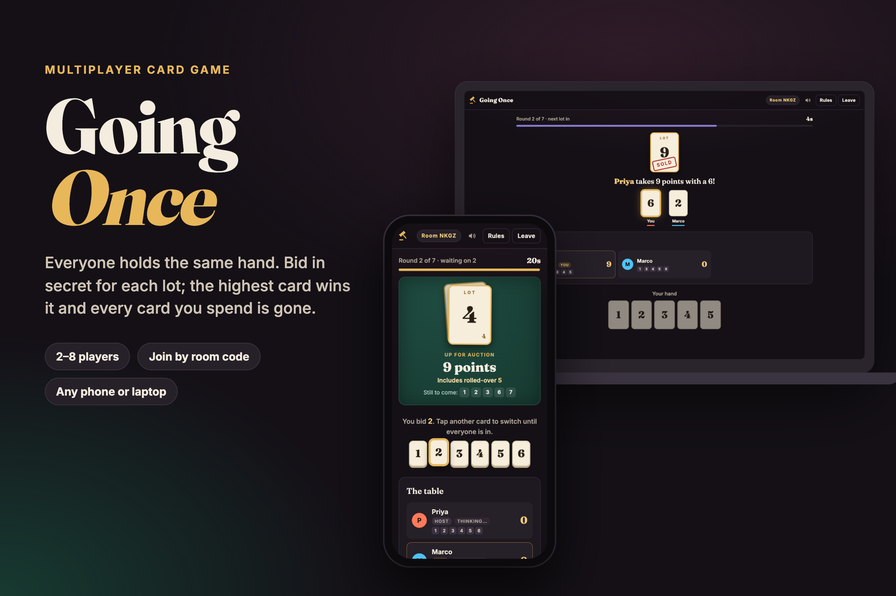

# Going Once

A sealed-bid card game for 2 to 8 players, each on their own phone or laptop.

**Play it:** https://gauravsigh.github.io/going-once/



One person hosts a room and gets a four-letter code. Everyone else opens the same page, types the code (or taps the invite link) and joins from wherever they are. Nobody needs an account or an app.

## How to play

1. Each player starts with the same hand: cards 1 to 10. The host can pick 7 or 13 instead.
2. Each round a lot card is flipped. It is worth its number in points.
3. Everyone secretly plays one card from their hand. You can switch cards until the last player is in.
4. When every card is down they all flip, and the highest card takes the lot. Every card you play is gone for the rest of the game, win or lose.
5. If the top card is tied, nobody wins and the lot stays in the pot for the next winner. A tie on the final lot means nobody gets it.
6. With the timer on, anyone who hasn't played when it runs out plays their lowest card automatically.
7. After the last card, the highest score wins. Equal scores share the win.

The table always shows the lots still to come and the cards each rival has left, so there is real counting to do. The bidding structure is the classic game-theory exercise known as Goofspiel, extended to more players with rollover pots and a turn timer.

## How it works

The site is static (GitHub Pages), so there is no game server to run or pay for.

The host's browser acts as referee. It holds the full game state, applies every action through a pure rules engine ([src/game.js](src/game.js)) and publishes a public view of the table. That view leaves out the order of the lot deck, and it hides the cards played in the current round until they flip.

Messages travel over public MQTT brokers on secure WebSockets. Players send intents (`join`, `bid`, `leave`) and the host answers with the new table. The host accepts start, kick and settings changes from its own screen only, so a message on the network that claims to come from the host is ignored.

The room code also picks the broker. The host connects to the first broker it can reach, and the first letter of the code records which one, so a joiner needs nothing but the code. If the first broker is down, new rooms land on the next one.

Presence uses MQTT last-will messages: when a tab closes or a phone drops its connection, the others see that player as offline. Each connection carries its own id, so a late "offline" from a tab that was just reloaded cannot overwrite the new "online".

Players and the host keep their seat in `sessionStorage` and drop back into the game after a reload. The host saves its state on every change, so a host refresh resumes the same round. Because `sessionStorage` is per tab, two tabs in one browser count as two players, which makes local testing easy.

### Trust model

This is built for friends playing together. The brokers are public, so someone who knows the room code and goes looking could read the raw traffic, including bids before they flip. The host's device also knows the deck order. If the host closes their tab for good, the room ends.

## Run it locally

```bash
npm install
npm run serve
```

Then open http://127.0.0.1:5173/ in two different browser windows (or one normal and one private window) and play against yourself. `npm install` is only needed for the tests and the dev server; the game itself has no build step.

## Tests

| Command | What it checks |
| --- | --- |
| `npm test` | Rules engine: joining, bidding, ties and rollovers, the timer, leaving, rematch, and that the public view hides the deck order and live bids. |
| `npm run test:broker` | A headless host and two remote players finish a full game over a live public broker and agree on the final standings. `--fallback` makes the first broker unreachable. |
| `npm run test:browser` | Two separate Chrome profiles, one laptop-sized and one phone-sized, create and join a room, reload mid-game, play every round and see the same winner. It also checks that nothing overflows a 375px screen. Uses your installed Google Chrome. |

## Project layout

```
index.html          page shell, rules text, dialogs
styles.css          all styling, phone first
src/game.js         rules engine (pure functions)
src/protocol.js     room codes, broker list, topic names
src/net.js          small wrapper over the MQTT client
src/host.js         host session: referee and publisher
src/client.js       player session
src/app.js          screens and UI
vendor/mqtt.esm.js  MQTT.js 5.16.0 browser build (MIT, see vendor/mqtt.LICENSE.md)
test/               unit, broker and browser tests, local server
```

## License

MIT. See [LICENSE](LICENSE).
